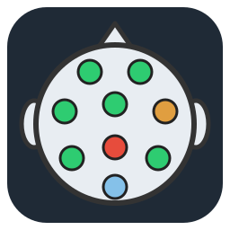

<p align="center">
  
</p>

# impedance-monitor

Standalone electrode impedance monitor for ANT Neuro eego amplifiers. It shows
per-electrode impedance in real time on a colour-coded head topomap, so you can
check cap preparation without opening the full eego software.

- Live impedance readout from the amplifier through the eego SDK
- Colour-coded topomap for the CA-209, CA-001 and CA-200 caps
- Mock mode for trying out the GUI without hardware
- A per-session log file recording how impedances changed during cap setup
- Runs on Linux and Windows, with PySide6 (Qt 6) or PyQt5 (Qt 5)

---

## Contents

- [Requirements](#requirements)
- [Installation](#installation)
- [Usage](#usage)
- [GUI overview](#gui-overview)
- [Cap layouts](#cap-layouts)
- [Impedance thresholds](#impedance-thresholds)
- [Logging](#logging)
- [Troubleshooting](#troubleshooting)
- [Development](#development)
- [SDK constraints](#sdk-constraints)

---

## Requirements

### System

| Requirement | Notes |
|---|---|
| OS | Linux or Windows 10/11 |
| Python | 3.10 or newer (3.12 recommended) |
| ANT Neuro eego SDK | `libeego-SDK.so` (Linux) or `eego-SDK.dll` (Windows). Obtained from ANT Neuro; not installable via pip or conda. Needed for live mode only. |
| USB access (Linux) | udev rule `90-eego.rules` (included in this repo) so you can use the amplifier without root |
| USB driver (Windows) | ANT Neuro USB driver, installed separately |

### Python packages

| Package | Version | Purpose |
|---|---|---|
| [PySide6](https://pypi.org/project/PySide6/) | ≥ 6.7 | Qt GUI library (default) |
| [qtpy](https://pypi.org/project/QtPy/) | ≥ 2.0 | Lets the same code run on PySide6 or PyQt5 |

Both are installed automatically by `pip install -e .`. The SDK is loaded with the
standard-library `ctypes`, so it doesn't need a Python wrapper package.

**Optional:**

| Package | Purpose |
|---|---|
| [PyQt5](https://pypi.org/project/PyQt5/) | Use instead of PySide6, e.g. in an existing MNE environment that already ships Qt 5 |
| [pytest](https://pypi.org/project/pytest/) | Running the test suite |

When PyQt5 and PySide6 are both installed, qtpy uses PyQt5. Set `QT_API=pyside6` to
use PySide6 instead.

---

## Installation

### Option 1 — installer script (recommended)

Activate a Python 3.10+ environment, then run the installer from the repo root:

```bash
conda activate <your-env>   # or: source .venv/bin/activate
cd /path/to/impedance-monitor
python install.py
```

`install.py` detects your platform and installs into whatever Python is active. It
will:

1. Check that Python 3.10+ is active
2. Locate the SDK library
3. **Linux only:** install the udev rule for USB access (asks for `sudo`)
4. Run `pip install -e .`, which installs the Python packages and registers the `impedance-monitor` command
5. Check the setup with `impedance-monitor --check`

If any step fails, the installer stops and prints instructions. Re-running
`python install.py` is safe; use it to upgrade.

### Option 2 — conda environment file

```bash
conda env create -f environment.yml
conda activate impedance-monitor
pip install -e .
```

You will still need to install the udev rule yourself (see
[Manual setup](#manual-setup)).

### Option 3 — into an existing environment

```bash
conda activate <your-env>
pip install -e .
impedance-monitor --check
```

**Using an MNE (or other Qt 5) environment?** Install `qtpy` and run it there
directly; qtpy will pick up the environment's PyQt5. See
[Troubleshooting](#qt-platform-plugin-xcb-could-not-be-loaded) if the window fails
to open.

### Locating the SDK

The SDK library is searched for in this order:

1. `--sdk-path` command-line argument
2. `EEGO_SDK_PATH` environment variable
3. `~/.config/impedance-monitor/sdk_path` (written by `install.py`)
4. Default locations:
   - Linux: `~/opt/lsl-eego/libeego-SDK.so`, `/opt/lsl-eego/libeego-SDK.so`
   - Windows: `~/opt/lsl-eego/eego-SDK.dll`
5. The library name on its own, found via `LD_LIBRARY_PATH` (Linux) or `PATH` (Windows)

If your SDK is somewhere else, set `EEGO_SDK_PATH` before running the installer:

```bash
# Linux
export EEGO_SDK_PATH=/path/to/libeego-SDK.so

# Windows
set EEGO_SDK_PATH=C:\path\to\eego-SDK.dll
```

If the SDK can't be found, live mode fails with an error; it never falls back to
mock mode on its own.

### Manual setup

**udev rule (Linux):**

```bash
sudo cp 90-eego.rules /etc/udev/rules.d/
sudo udevadm control --reload-rules && sudo udevadm trigger --subsystem-match=usb
```

Unplug and reconnect the amplifier afterwards.

**Desktop launcher (Linux):** create `~/Desktop/impedance-monitor.desktop`:

```ini
[Desktop Entry]
Name=Impedance Monitor
Comment=Check ANT Neuro electrode impedances
Exec=/path/to/conda/envs/<your-env>/bin/impedance-monitor
Icon=/path/to/impedance-monitor/icon_impedance_monitor.svg
Terminal=false
Type=Application
Categories=Science;Utility;
```

Then right-click the launcher and choose **Allow Launching**.

---

## Usage

```bash
# Live mode (amplifier connected)
impedance-monitor --mode live --cap ca209

# Mock mode, no hardware needed
impedance-monitor --mode mock --cap ca209

# Pre-fill subject and data directory (both still editable in the GUI)
impedance-monitor --mode live --cap ca209 --subject PILOT007 --data-dir /data/eeg

# Custom SDK location
impedance-monitor --mode live --sdk-path /opt/antneuro/libeego-SDK.so   # Linux
impedance-monitor --mode live --sdk-path C:\ANT\eego-SDK.dll            # Windows

# Check the setup without connecting to the amplifier
impedance-monitor --check
```

### Command-line options

| Option | Default | Description |
|---|---|---|
| `--mode {live,mock}` | `live` | Acquisition mode |
| `--cap {ca209,ca001,ca200}` | `ca209` | Cap layout |
| `--poll-ms INT` | `500` | Polling interval in milliseconds |
| `--subject SUBJECT_ID` | — | Subject ID used in the log directory. Must be given together with `--data-dir`. |
| `--data-dir PATH` | — | Root data directory. Must be given together with `--subject`. |
| `--sdk-path PATH` | — | Explicit path to the SDK library |
| `--check` | — | Check the setup and exit; doesn't connect to the amplifier |

Command-line options only fill in the GUI fields at startup. Once the window opens,
adjust anything you need, then click **▶ Start** to connect to the amplifier and
begin acquisition.

---

## GUI overview

```
┌──────────────────────────────────────────────────────────────────┐
│ Mode: [LIVE▼]  Cap: [CA-209▼]  Poll interval (ms): [500]        │  ← config row 1
│ Subject: [________]  Log dir: [_____________________________]    │
│                                            [▶ Start]  [■ Stop]   │  ← config row 2
├──────────────────────────────────────────────────────────────────┤
│                                                                   │
│              [colour-coded electrode topomap]                     │  ← head widget
│              [label in circle, status/kΩ below]                   │
│                                                                   │
├──────────────────────────────────────────────────────────────────┤
│ Status: Connected  Battery: 85%  Poll: 500ms  Updated: 10:23:45  │  ← status bar
│                                        [Save Snapshot]  [Quit]   │
└──────────────────────────────────────────────────────────────────┘
```

**Electrode circles** have the channel label inside and a value just below. Good,
Marginal and Bad channels show their impedance in kΩ (e.g. `4.5K`, `30K`). Dry
channels show `>1MΩ`. Short and Open channels show `Short` or `Open`. REF and GND are
drawn outside the head outline at fixed positions.

Hover over an electrode to see a tooltip with its exact impedance and status.

**Updated timestamp:** the status bar time refreshes on every successful poll, so you
can tell at a glance if the display has stopped updating.

---

## Cap layouts

| Name | Electrodes | Description |
|---|---|---|
| `ca209` | 32 EEG + GND + REF | Default cap |
| `ca001` | 32 EEG + GND + REF | Alternate 32-channel cap |
| `ca200` | 64 EEG + GND + REF | High-density cap |

---

## Impedance thresholds

| Status | Range | Colour |
|---|---|---|
| Good | 100 Ω – 50 kΩ | Green |
| Marginal | 50 – 200 kΩ | Orange (gradient) |
| Bad | 200 kΩ – 1 MΩ | Red |
| Short | < 100 Ω | White |
| Open | SDK no-contact value | Light blue |
| Dry | ≥ 1 MΩ, needs gel | Light blue |

- **Short** (< 100 Ω): values this low aren't physically plausible for real scalp
  contact, so they indicate a shorted electrode (SDK issue 3165).
- **Open** (SDK value 0xFFFFFFFF): the amplifier reports no contact. The cap isn't
  seated or the electrode is lifted.
- **Dry** (≥ 1 MΩ but not the no-contact value): the cap is seated but the electrode
  hasn't been gelled yet.

---

## Logging

Each session writes one `.log` file:

```
{log_dir}/impedance_monitor_{timestamp}.log
```

The default log directory is chosen in this order:

1. A Harmony `config.py` on `sys.path`: `{DATA_DIR}/sub-{TRAINING_SUBJECT}/impedance_logs/`
2. `--data-dir` and `--subject`: `{data_dir}/sub-{subject}/impedance_logs/`
3. Otherwise: `~/impedance_logs/`

You can change the log directory in the GUI before clicking Start.

The log file contains everything printed to the terminal. Impedance readings are
logged at most once per second, however fast the polling rate, so the file is a
readable record of how impedances changed during cap setup:

```
2026-04-06 10:23:45,123 [INFO] Session started. Log: /home/.../impedance_logs/...
2026-04-06 10:23:45,456 [INFO] Acquisition started. Mode=LIVE Cap=CA-209 Poll=500ms Log=/home/.../impedance_logs
2026-04-06 10:23:46,001 [INFO] Readings: FP1=4.2K FPz=3.1K ... GND=open REF=2.1K  [28G 2M 0B 2O 0D]
2026-04-06 10:24:46,003 [INFO] Readings: FP1=3.8K FPz=2.9K ... GND=open REF=1.9K  [30G 0M 0B 2O 0D]
```

The `[28G 2M 0B 2O 0D]` suffix counts the Good / Marginal / Bad / Open / Dry channels.

---

## Troubleshooting

### Qt platform plugin "xcb" could not be loaded

```
qt.qpa.plugin: Could not find the Qt platform plugin "xcb" in ""
Aborted (core dumped)
```

This usually means Qt 5 and Qt 6 are both installed in one environment (common in
MNE environments). PySide6 found Qt 5's `xcb` plugin and rejected it. To confirm:

```bash
QT_DEBUG_PLUGINS=1 impedance-monitor --mode mock 2>&1 | grep -i incompatible
```

Fixes, in either order:

- Make sure `qtpy` is installed (`pip install qtpy`) so the app uses the
  environment's PyQt5, or
- Install the monitor in its own environment (Option 1 or 2 above), where only
  PySide6 is present.

### SDK library not found

Run `impedance-monitor --check` to see which paths were searched. Then point to the
library with `--sdk-path` or `EEGO_SDK_PATH`, or re-run `python install.py`.

### Amplifier not detected / stream fails to open

- Close eegoSports or any other program using the amplifier. The SDK allows only
  one stream at a time.
- **Linux:** check the udev rule is installed (`impedance-monitor --check`), then
  reconnect the amplifier.

---

## Development

### Project layout

```
impedance_monitor/
├── main.py                  # CLI entry point and --check
├── acquisition/
│   ├── base.py              # Backend interface
│   ├── eego_sdk.py          # ctypes wrapper around the eego SDK (only module that loads it)
│   └── mock.py              # Simulated backend for mock mode
├── cap_layouts/             # Electrode positions per cap
├── gui/
│   ├── main_window.py       # Main window, controls, polling timer
│   └── head_widget.py       # Topomap drawing
├── logging_session/
│   └── session_log.py       # Per-session log file
└── processing/
    └── thresholds.py        # Impedance → status classification
tests/                       # pytest suite
```

### Running tests

```bash
pip install pytest
python -m pytest
```

Tests that need the SDK headers or the SDK library are skipped automatically if they
aren't present.

---

## SDK constraints

- Only one eego stream can be active at a time. Close eegoSports before running
  live mode.
- The first `getData()` result after opening a stream is discarded, because it
  contains wrong values (SDK issue 3162).
- On shutdown, the tool calls `eemagine_sdk_exit()`. Quit with the Quit button or by
  closing the window, not by killing the process.
